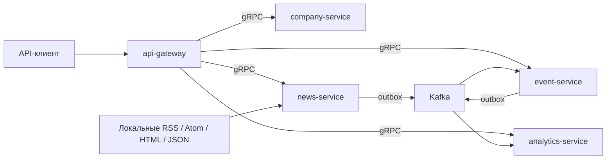

# Первый контур бэкенда

Документ описывает базовую итерацию. Текущее расширение до семи Go-процессов,
LLM-обработка, карточки и чат описаны в [backend-llm.md](backend-llm.md).

В этой итерации реализованы пять независимых процессов Go. Остальные пять
прикладных сервисов зарезервированы под последующие этапы. PostgreSQL и Kafka —
инфраструктура, а не дополнительные прикладные микросервисы.

## Владение данными

Один физический PostgreSQL содержит схемы `auth`, `company`, `news`, `events` и
`analytics`. У каждой своя роль. Миграции применяются только владельцем своей схемы.
Транзакции и внешние ключи используются внутри границы сервиса.

Идентификатор компании берётся из серверной сессии. Профиль и ручные загрузки
доступны только своей компании. У публичных публикаций `scope=public`; у приватных
объектов `scope=company:<id>`. Эта область передаётся в сообщениях и проверяется
при чтении и обработке. Private/public не смешиваются при точной дедупликации.

## Авторизация

Шлюз хранит пользователей и сессии. Пароли хешируются bcrypt с cost 12.
Сессия содержит криптографически случайный токен; в БД хранится SHA-256 токена.
При новом входе сессия этого браузера заменяется. Выход удаляет сессию.

Сессионные cookie HttpOnly, SameSite=Lax; production требует Secure. Для POST
после входа нужен CSRF-токен, привязанный к сессии. Origin сверяется с конфигурацией.
Попытки входа ограничиваются отдельно по IP и аккаунту за минутное окно.
Заголовкам X-Forwarded-For без отдельной настройки доверенного прокси не доверяем.

Внутренний контекст — подписанные claims с пользователем, компанией, аудиторией,
сроком жизни и correlation_id. Неподписанные вызовы gRPC отклоняются. Общий HMAC-ключ
применяется только между доверенными процессами MVP. Сетевой TLS/mTLS и раздельные
ключи сервисов относятся к подготовке production, а не к этой локальной сборке.

## Версии и результаты

Компания имеет историю профилей. Новая версия записывается с проверкой ожидаемого
номера; параллельные обновления одной версии конфликтуют. Отсутствующее покрытие
графа и неизвестные экспозиции сохраняются как null.

У публикации есть постоянный ID и история ревизий. Изменение содержимого,
существенных метаданных или версии правил извлечения создаёт ревизию. Повторная
загрузка той же версии не создаёт новую запись outbox.

Событие пока является **кандидатом**. Точное совпадение текста позволяет приложить
несколько источников. Смысловую эквивалентность код не утверждает. Изменение
публикации увеличивает версию кандидата и сбрасывает старые теги.
`event_articles` допускает несколько событий на публикацию. Разделение одной
публикации на несколько смысловых событий будет выполнять ML-обработчик.

Переходы кандидата: `awaiting_tagging` → `tagged`. Результат тегирования принимается
только для актуальной версии снимка. `input_revision` в Tags обозначает версию
входного кандидата события. Запоздалый ответ не заменяет новый результат.

## Доставка сообщений

Публикация и outbox записываются атомарно. Publisher читает outbox с
`FOR UPDATE SKIP LOCKED`; после подтверждения брокера отмечает отправку. При сбое
между отправкой и фиксацией возможен повтор — это ожидаемое поведение.

Потребитель одной транзакцией фиксирует message_id в inbox и бизнес-изменения.
Offset подтверждается после commit. Повторы пропускаются, старые версии объектов
не применяются. Невалидное сообщение сохраняется в dead_letters и создаёт outbox
для `processing.dlq.v1`. В DLQ не отправляем приватный исходный текст.

Ошибки одной партиции не приводят к пропуску уже полученных сообщений других
партиций. При временной ошибке позиция неуспешной партиции возвращается назад.

## Наблюдаемость

У каждого процесса есть `/healthz`, `/readyz`, `/metrics`. Готовность проверяет
свою БД. При недоступности Kafka сбор может сохранять публикации и outbox, поэтому
готовность HTTP не зависит от брокера. Очередь outbox и её возраст показывают
необходимость восстановления доставки.

News-метрики содержат запуски, статусы заданий, время между созданием и изменением
задания, длительность сбора, свежесть источника и ошибки. Это эксплуатационные
показатели, а не метрики точности отбора. Analytics считает сообщения идемпотентно
с фильтрацией приватных счётчиков по компании.

## Граница ML

Бэкенд хранит Company/Profile, принимает Tags и оставляет контракты Match, Insight,
Trace. Каналы имеют фиксированные машинные имена и источник data/matrix/llm.
Синтетические веса в демо не представляют результат калибровки. Качество, полнота
отбора, семантическая дедупликация и матрицы в этой итерации не рассчитываются.
